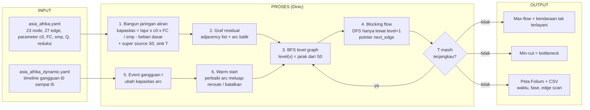
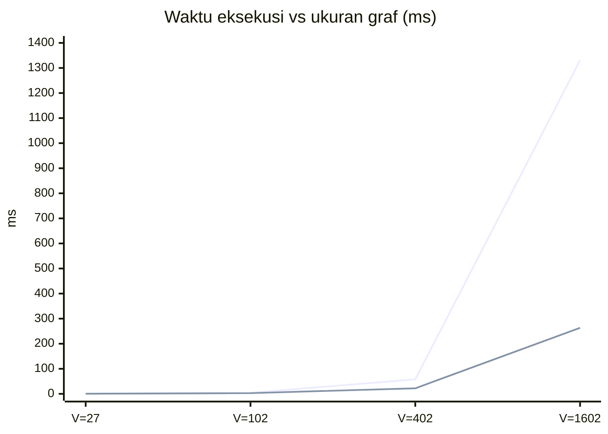

# Materi Video — Bagian 3.2, 4.1, dan 4.2

Domain: **Max-Flow** — koridor Asia Afrika, Bandung (hari konvoi)
Basic: **Ford-Fulkerson (BFS / Edmonds-Karp)** · Advance: **Dinic** (+ *warm start* inkremental untuk graf dinamis)

> Semua angka di bawah berasal dari kode di repo ini (median 300x pengulangan, Python 3.14, laptop lokal).
> Angka ms akan sedikit beda di laptop lain, tetapi **jumlah fase / augmenting path / edge scan selalu sama** (tidak bergantung mesin).
> Reproduksi:
>
> ```powershell
> python -m scripts.run_benchmark_detail   # Bagian 4.1
> python -m scripts.run_dynamic            # Bagian 4.2
> python -m pytest                         # 55 test, termasuk uji warm start
> ```

---

## BAGIAN 3.2 — Pipeline Input → Proses → Output (± 4–5 menit)

> [!IMPORTANT]
> Jangan membacakan kode baris per baris. Tampilkan diagram di bawah, lalu jelaskan tiap kotak.



### Naskah narasi

**Input.**
"Input kami ada dua file YAML. Yang pertama, `asia_afrika.yaml`, berisi 23 simpul nyata: 4 pintu masuk, 10 simpul koridor, 7 kantong parkir, dan 2 titik bantu Gmaps. Ada juga 27 ruas jalan yang punya atribut jumlah lajur, arah (satu atau dua arah), dan beban dasar lalu lintas. Yang kedua, `asia_afrika_dynamic.yaml`, berisi kejadian di lapangan per jam, misalnya ruas yang ditutup atau parkir yang tergenang. Di memori, graf disimpan sebagai **adjacency list residual**. Kami tidak memakai matriks karena grafnya jarang (sparse): hanya 60 arc dari 25² kemungkinan."

**Proses (alur Dinic).**
1. **Transformasi ke jaringan aliran.** "Setiap ruas diberi kapasitas `lajur × c0 × FC / smp`, lalu dikurangi beban dasar. Saat konvoi, ruas di simpul macet dikali (1 − 0,4). Semua pintu masuk kami sambungkan ke *super source* S0, dan kapasitas S0 dibatasi demand Q = 5000 kendaraan. Semua kantong parkir kami sambungkan ke *super sink* T dengan kapasitas sebesar daya tampungnya. Dengan cara ini, persoalan banyak-sumber banyak-tujuan jadi satu persoalan s–t."
2. **Graf residual.** "Untuk setiap arc kami buat arc balik berkapasitas 0. Arc balik inilah yang nanti dipakai untuk 'membatalkan' aliran."
3. **BFS → level graph.** "Di sinilah Dinic berbeda dari Ford-Fulkerson. Ford-Fulkerson melakukan BFS hanya untuk mencari **satu** jalur, lalu mengulang BFS dari awal. Dinic melakukan BFS satu kali untuk memberi setiap simpul label level, yaitu jaraknya dari S0."
4. **Blocking flow (DFS).** "Setelah itu, DFS mengirim aliran **berkali-kali** dalam satu fase, tapi hanya boleh lewat edge yang naik tepat satu level. Ada pointer `next_edge`: edge yang sudah buntu tidak akan diperiksa lagi selama fase itu. Satu fase selesai ketika semua jalur terpendek sudah jenuh."
5. **Ulangi** langkah 3–4 sampai T tidak terjangkau lagi dari S0. Panjang jalur terpendek pasti naik setiap fase, jadi jumlah fase paling banyak V. Kompleksitasnya O(V²E), sedangkan Edmonds-Karp O(VE²).
6. **Pembaruan lingkungan (graf dinamis).** "Ketika ada event pada jam t, kami tidak menghitung ulang dari nol. Graf residual dari jam sebelumnya kami simpan, lalu hanya arc yang berubah yang diperbaiki:
   - kapasitas baru masih ≥ aliran lama → cukup ubah sisa kapasitasnya;
   - kapasitas baru < aliran lama (aliran *meluap* sebanyak δ) → aliran pertama-tama coba dialihkan lewat jalan lain (u → v). Kalau tidak bisa, sisanya dibatalkan (u → S0 dan T → v);
   - setelah itu fase Dinic dilanjutkan dari S0 ke T."

**Output.**
"Output-nya ada tiga. (1) Nilai max-flow dan jumlah kendaraan yang tidak terlayani, yaitu Q − max-flow. (2) Min-cut, yaitu himpunan arc yang menjadi *bottleneck*, diambil dari simpul yang masih terjangkau di graf residual. (3) Visualisasi peta Folium (warna ruas menunjukkan tingkat utilisasi) dan file CSV metrik di folder `results/`: waktu eksekusi, jumlah fase, augmenting path, dan edge scan."

---

## BAGIAN 4.1 — Benchmarking (± 3–4 menit)

### Tabel 1 — Graf kasus Asia Afrika (V = 25, E = 60 arc)

| Skenario | Algoritma | Max-flow | Waktu (ms) | Fase BFS | Augmenting path | Edge scan |
|---|---|---|---|---|---|---|
| Normal | Ford-Fulkerson | 2700 | **0,155** | 8 | 7 | **694** |
| Normal | Dinic | 2700 | 0,220 | **3** | 7 | 842 |
| Konvoi | Ford-Fulkerson | 2700 | **0,164** | 8 | 7 | **694** |
| Konvoi | Dinic | 2700 | 0,198 | **3** | 7 | 842 |

Min-cut pada kedua skenario: `P1..P7 → T` (seluruh kantong parkir, total 2700).

### Tabel 2 — Uji skalabilitas (graf grid sintetis, kapasitas acak seed 2026)

| Grid | V | Ford-Fulkerson (ms) | Dinic (ms) | Speed-up Dinic | Fase FF : Dinic | Edge scan FF : Dinic |
|---|---|---|---|---|---|---|
| 5×5 | 27 | 0,362 | 0,437 | 0,83× | 14 : 5 | 1.947 : 1.776 |
| 10×10 | 102 | 4,25 | 2,85 | 1,5× | 48 : 10 | 28.679 : 13.301 |
| 20×20 | 402 | 58,0 | 22,1 | 2,6× | 139 : 16 | 389.762 : 95.783 |
| 40×40 | 1602 | 1331,1 | 263,4 | **5,1×** | 703 : 43 | 8,5 jt : 1,0 jt |



*(garis atas = Ford-Fulkerson, garis bawah = Dinic)*

### Naskah analisis kritis (overkill vs optimal)

- **Kedua algoritma sama-sama benar.** Max-flow keduanya sama (2700), dan min-cut-nya juga sama. Ini sesuai teorema Max-Flow Min-Cut.
- **Untuk graf Asia Afrika, Ford-Fulkerson justru ±15–30% lebih cepat (0,155 vs 0,220 ms; 0,164 vs 0,198 ms).** Penyebabnya:
  1. Hanya ada 7 augmenting path, karena bottleneck-nya ada di kapasitas parkir, bukan di jalan. Akibatnya Ford-Fulkerson cukup melakukan 8 BFS.
  2. BFS di Ford-Fulkerson **berhenti begitu T ditemukan**, sedangkan BFS Dinic harus memberi level ke **seluruh** simpul. Selain itu ada biaya tambahan untuk DFS rekursif dan pointer. Hasilnya, edge scan Dinic lebih banyak (842 vs 694).
  → Pada V ≈ 25, keunggulan Dinic (fase lebih sedikit: 3 vs 8) belum bisa menutup biaya tambahan per fasenya. **Untuk ukuran graf ini, Dinic adalah *overkill*.**
- **Titik balik (crossover) ada di antara V ≈ 30 dan V ≈ 100.** Pada V = 27, Dinic masih lebih lambat (0,83×). Pada V ≈ 100, Dinic sudah 1,5× lebih cepat. Pada V = 1602, Dinic 5,1× lebih cepat karena jumlah fasenya hanya 43, sedangkan Ford-Fulkerson butuh 703 BFS. Kalau model diperluas ke seluruh jaringan jalan Kota Bandung (ribuan simpul), Dinic jelas pilihan yang tepat.
- **Memori praktis sama** (±22 KiB pada kasus ini). Struktur residualnya identik; Dinic hanya menambah array level dan pointer, yaitu O(V).

---

## BAGIAN 4.2 — Simulasi Graf Dinamis (± 4–5 menit)

### Timeline gangguan (`cases/scenarios/asia_afrika_dynamic.yaml`)

| t | Jam | Kejadian | Max-flow | Tak terlayani | Min-cut / bottleneck |
|---|---|---|---|---|---|
| 0 | 07.00 | Kondisi normal | 2700 | 2300 | P1..P7 → T |
| 1 | 08.00 | Konvoi mulai: ruas di simpul macet −40% | 2700 | 2300 | P1..P7 → T |
| 2 | 09.00 | **J5→J10 ditutup total** (area finis JPO) | **2200** | 2800 | P2 hilang dari cut (tak terjangkau) |
| 3 | 10.00 | Hujan + parkir liar: Jl. Sudirman P6–E3 tinggal 25% | 2200 | 2800 | tetap |
| 4 | 11.00 | **Basement Alun-Alun (P1) tergenang** | **1700** | 3300 | P3..P7 → T |
| 5 | 13.00 | Konvoi selesai, J5→J10 & Sudirman pulih (P1 masih tergenang) | 2200 | 2800 | P2..P7 → T |

### Respons algoritma per langkah waktu

| t | Aliran jam sebelumnya masih layak? | FF ulang dari nol (ms / scan) | Dinic ulang dari nol (ms / scan) | Dinic warm start (ms / scan) | Perbaikan warm start |
|---|---|---|---|---|---|
| 0 | – | 0,173 / 694 | 0,196 / 842 | 0,222 / 842 (cold) | – |
| 1 | ya | 0,160 / 694 | 0,201 / 842 | **0,072 / 112** | 28 arc berubah, 0 meluap, 0 augmentasi |
| 2 | **TIDAK** — J5→J10 lebih 500 | 0,149 / 563 | 0,191 / 787 | **0,111 / 462** | 500 tak bisa dialihkan → dibatalkan |
| 3 | **TIDAK** — E3→P6 lebih 250 | 0,172 / 663 | 0,210 / 789 | **0,095 / 303** | 250 **dialihkan** ke pintu lain |
| 4 | **TIDAK** — P1→T lebih 500 | 0,131 / 463 | 0,177 / 781 | **0,086 / 329** | 500 dibatalkan |
| 5 | ya | 0,137 / 587 | 0,215 / 836 | **0,119 / 349** | kapasitas naik → 1 augmentasi tambahan |

Dibanding Dinic yang menghitung ulang dari nol, warm start **1,7–2,8× lebih cepat** dan memeriksa **41–87% lebih sedikit edge**. Dibanding Ford-Fulkerson dari nol, warm start 1,2–2,2× lebih cepat. Hasil max-flow-nya selalu sama (diverifikasi otomatis di skrip dan di `tests/test_incremental_dinic.py`, termasuk 40 graf acak).

### Naskah jawaban pertanyaan analitis

**1. Bagaimana respons algoritma klasik? Apakah harus menghitung ulang dari nol?**
"Ya. Ford-Fulkerson, dan juga Dinic versi biasa, tidak menyimpan state. Setiap ada event, seluruh aliran di-reset ke nol lalu semua augmenting path dicari lagi. Contohnya pada jam 08.00: max-flow sama sekali tidak berubah dan aliran lama masih layak, tapi Ford-Fulkerson tetap menjalankan 8 BFS (694 edge scan). Versi advance kami cukup memeriksa 112 edge dan tidak melakukan augmentasi sama sekali, karena ia tahu tidak ada aliran yang rusak."

**2. Apakah solusinya masih optimal global, terjebak di optimal lokal, atau malah tidak layak?**
- "Kalau **solusi lama dipakai apa adanya**, solusinya **tidak layak (infeasible)**. Pada jam 09.00, 10.00, dan 11.00, aliran lama melanggar kapasitas: misalnya 500 kendaraan masih diarahkan lewat J5→J10 yang sudah ditutup. Jadi solusi wajib diperbarui."
- "Setelah diperbarui, hasilnya **tetap optimum global**, baik dengan Ford-Fulkerson maupun Dinic warm start. Max-flow tidak mengenal optimum lokal. Teorema Max-Flow Min-Cut menjamin bahwa aliran layak yang tidak punya augmenting path lagi pasti maksimum. Warm start kami selalu diakhiri dengan fase Dinic sampai T tidak terjangkau, jadi syarat itu terpenuhi. Arc balik residual memungkinkan algoritma 'menarik kembali' keputusan yang salah, sehingga tidak bisa terjebak seperti greedy."
- "Yang **bisa** terjebak justru heuristik *greedy* tanpa arc balik, misalnya langsung mengisi ruas terbesar dulu. Itulah alasan kita butuh graf residual."

**3. Insight untuk isu nyata (jembatan ke Bagian 5).**
- **Kemacetan konvoi tidak menurunkan max-flow** (tetap 2700). Bottleneck-nya ada di **daya tampung parkir (2700 dari demand 5000)**, bukan di lebar jalan. Artinya, menambah kantong parkir lebih efektif daripada melebarkan jalan.
- **Eks Palaguna (P2) adalah titik rawan tunggal (*single point of failure*).** P2 hanya bisa dijangkau lewat ruas satu arah J5→J10. Begitu ruas itu ditutup, kapasitas 500 kendaraan langsung hilang. Rekomendasinya: buat akses alternatif ke P2 atau rekayasa arah lalu lintas.
- **Gangguan Jl. Sudirman (jam 10.00) tidak menurunkan max-flow.** 250 kendaraan bisa dialihkan ke pintu masuk lain, sehingga jaringan masih punya redundansi di sisi barat.

---

## File yang ditambahkan / diubah

| File | Isi |
|---|---|
| `algorithms/maxflow/dinic.py` | Dinic di-refactor jadi `dinic_augment()` yang bisa dipakai ulang + counter `stats` (perilaku sama) |
| `algorithms/maxflow/ford_fulkerson.py` | Ditambah counter `stats` (perilaku sama) |
| `algorithms/maxflow/incremental_dinic.py` | **Baru** — Dinic warm start untuk graf dinamis |
| `core/dynamic_events.py` | **Baru** — loader timeline gangguan |
| `cases/scenarios/asia_afrika_dynamic.yaml` | **Baru** — skenario t0–t5 |
| `scripts/run_benchmark_detail.py` | **Baru** — benchmark 4.1 (+ uji skalabilitas) |
| `scripts/run_dynamic.py` | **Baru** — simulasi 4.2 |
| `scripts/bench_utils.py` | **Baru** — utilitas timing/CSV |
| `tests/test_incremental_dinic.py` | **Baru** — 41 test warm start vs hitung ulang |
| `results/*.csv` | Hasil mentah untuk grafik/slide |
